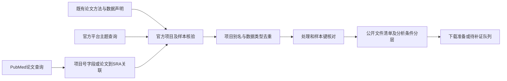

# 宏基因组／宏转录组数据发现：实际执行方法

本说明从截至 `0f9eeec20bc23a421165c8cff352137ba68fac48` 的保存材料和提交历史离线重建；本次不发起新数据平台/文献检索、不重新筛选、不下载FASTQ或重下论文。目标不是再列一份文章，而是判断哪些群落shotgun DNA/RNA数据能复用于氧响应、ARG/MGE或病毒—宿主探索。

[当前入口](../README.md) · [全部主题检索式、分页与响应](QUERY_APPENDIX.md) · [60项目实际选择顺序](SELECTION_AUDIT.md) · [487项目来源成员表](project_pool_membership_utf8.csv) · [提交阶段快照](../../method_audit/stage_history.json)

## 1. 与AD库和机制检索的关系

这里AD为厌氧消化，MG为群落总DNA的宏基因组，MT为群落RNA转为cDNA后的宏转录组；reads指原始测序读段。ARG为抗生素抗性基因，MGE为移动遗传元件。

原 `omics_screening` 已根据论文方法审计测序类型，本工作线先复用这些成果，再双向连接论文和官方数据记录。机制综述允许纯培养、酶学、16S等证据；本工作线的主集合则要求**群落MG/MT原始reads**，因而一篇机制很强的纯培养研究仍可能不属于可复用的群落数据。原件、原ID、旧AD范围排除和用户人工判断全部保留，不重新从554篇/426条审计库开始筛全文。

没有在数据平台查询中发送发表年或归档日期过滤，也没有ARG、virus、MGE强制关键词：原论文未研究这些对象的群落shotgun仍可能适合重注释。已有22篇的年代由原库决定；新增项目包含较早数据和新近归档，不能把机制文献的2012年至今过滤移植到本工作线。

|层次/类别|研究问题与用途|现有标签的实际边界|
|---|---|---|
|A核心方向|AD/产甲烷体系有氧/空气处理和厌氧对照，可检验目标过程|表内A是研究相关性层；其中处理键、采样时点仍可能未核完，不等于全部已满足可分析条件|
|B扩展方向|厌氧富集、发酵、沉积物、土壤等氧冲击、持续微氧、间歇/阶段供氧及恢复|优先对照/时间序列；部分仅方向符合、分组/剂量尚缺，保留候选|
|C背景|没有明确可匹配供氧干预的环境/功能参考、基因目录背景|可辅助参考注释或分布描述，不能与A/B合并推断氧效应|
|特殊数据|纯培养基因组/转录组、单细胞/WGA、病毒富集等|单列，不混群落主集合；混合项目按run区分|
|非目标或派生|16S/18S/ITS、扩增子功能预测；或仅定位组装/MAG/目录|扩增子不作为目标；派生数据另列，不替代raw reads|

层次是模型结合已存论文方法和官方元数据逐项写入的判断，[project_assessments.json](../project_assessments.json)保留依据，并非根据一个关键词或平台标签自动纳入。例如PRJNA1086167虽为AD，实际缺匹配氧比较且有样本键冲突，现放B；A层5个公开项目也只有2个旧AD项目的比较键由既有全文与官方记录共同确认。分层不代替可用性和设计核验。

## 2. 先复核原22篇，具体做了什么

[bootstrap.py](../scripts/bootstrap.py)从原[screening_records.json](../../omics_screening/screening_records.json)筛选 `conclusion.startswith('确认宏')`，得到**21 MG+1 MT**，不是22 MG再加MT。没有按包含“目标”筛选，因为“未使用目标”也可能命中。旧审计为助手按保存全文证据编制，不称用户复核；用户人工分类仍是原AD独立字段。旧审计总计426行，另有530条证据、452行不同层级的数据记录，这些行数均不是项目数。

为22篇复制了54条相关方法/数据证据、目标数据行和已有项目关联，原文件不改。10篇有目标项目关联，归到9个BioProject；另12篇分别保留索取/未定位/限制状态。旧页码、剂量原单位、测序和重复说明见[逐篇可用性审计](../existing_articles_availability_audit.json)、[54条复用证据](../existing_target_evidence.json)，对应构建逻辑在[build_existing_audit.py](../scripts/build_existing_audit.py)。

[collect_projects.py](../scripts/collect_projects.py)逐项目取ENA完整filereport、NCBI SRA精确项目号ESearch/EFetch、ENA项目XML。SRA检索每页200 UID，EFetch每100 UID，按官方实验/样本/Run解析；ENA字段清单先核可用列。UID常对应实验，EFetch可含多个run，因此不把UID数当run数。缓存按项目保存，不复制旧虚拟环境或重下论文。

|原22篇审计结果|实际含义|
|---|---|
|7个项目有公开目标reads清单|原论文关联49个run，完整项目又发现2个厌氧WGS，共51 run、48归档BioSample；不是51个独立生物样本|
|2个有号但未检出公开run|PRJNA1369098、PRJNA1438379；当前SRA/ENA均未定位目标run，不足以断言私有、不存在或从未上传|
|1篇明确reads可索取|R13274明确raw metatranscriptomic reads，需用途/协议；没有公开编号，不标公开可下载，不代联系|
|6篇泛指数据可索取|是否包含原始reads不明确，不能等同上一类|
|其余限制/缺口|R13817明确作者无权分享；另4篇未定位目标编号/声明或存在矛盾，保留具体说明。R13904的项目号对应16S，不能当MG编号|

PRJNA1013451被R09236/R12985两文复用，按同项目/同数据关联，不重复计算。R07202的PRJNA565588原来仅关联2个微曝气WGS，本轮找到了额外2个厌氧WGS，但它们的日期、布局和别名有差异，所以没有因出现对照标签就自动构成氧效应比较。

## 3. 双向发现的来源、语法与实际覆盖



|实际来源|执行内容|边界|
|---|---|---|
|ENA read_run search|16组study_title/description与library_source组合|是run层查询，不是全文检索；description在保存字段表中定义为brief sequence description，不是整个BioProject摘要|
|NCBI BioProject ESearch/EFetch|4组主题查询，完整ID分页和记录|不是同样4组在SRA又做了一次广泛主题检索|
|NCBI SRA|项目号精确核验；PubMed→SRA ELink及UID ESummary定位项目|承担数据核验/关联，不能将全部SRA返回说成独立发现研究|
|PubMed|4组主检索+4组项目追溯；完整ID与元数据|只有P01显式限定Title/Abstract，其余自动映射；一次短语扩展导致大量背景返回|
|BioProject Publication字段|从项目回查PMID/DOI，再补论文元数据|有论文关联不证明该项目的全部run都属于该文或都符合目标|
|NCBI Assembly|精确查3个未定位raw的项目，取组装记录和官方路径|派生数据核验，不下载组装或FASTQ，也不证明其他关联项目没有raw|
|GSA|仅入口连通性测试，代理403|没有执行GSA平台查询；返回数未知，不是0。PRJCA039809仅从ENA/DDBJ官方样本属性识别为别名|
|nature-academic-search|沿用技能的来源策略与官方API替代路径|本轮未挂载可调用的技能MCP；不能把已安装说成调用成功；没有新增WoS/Scopus检索|

实际逻辑是“氧情境 × 厌氧对象/环境 × 群落数据类型”分组，不要求每组同时包含全部词。ENA的宽组如E03以oxygen与anaerob/methan/syntroph/ferment相交，E05转向sediment/soil/peat/wetland，E14专找氧相关METATRANSCRIPTOMIC；BioProject N02加入exposure/shock/pulse/intrusion/reoxygenation，N03侧重redox/intermittent/side-stream；PubMed P01–P04用论文摘要补项目标题检索的遗漏。

完整输入式、字段、日期、实际参数、分页、报告量和响应链接见[检索式附表](QUERY_APPENDIX.md)；[所有请求登记CSV](request_register_utf8.csv)还包括逐项目编号核验及论文关联。实际脚本为[discover_ena.py](../scripts/discover_ena.py)、[discover_ncbi.py](../scripts/discover_ncbi.py)、[link_papers.py](../scripts/link_papers.py)、[resolve_paper_sra.py](../scripts/resolve_paper_sra.py)、[supplement_links.py](../scripts/supplement_links.py)。

三个代表性实际输入（数据工作线ID；全部组和实际参数见附表）：

E05：

```text
(study_title="*oxygen*" AND (study_title="*sediment*" OR study_title="*soil*" OR study_title="*peat*" OR study_title="*wetland*")) AND (library_source="METAGENOMIC" OR library_source="METATRANSCRIPTOMIC")
```

N02：

```text
("oxygen exposure" OR "oxygen shock" OR "oxygen pulse" OR "oxygen intrusion" OR reoxygenation) AND (anaerob* OR methanogen* OR syntroph* OR sediment OR fermentation) AND (metagenom* OR metatranscriptom*)
```

P01：

```text
(microaerat*[Title/Abstract] OR microaerob*[Title/Abstract] OR microoxic[Title/Abstract]) AND (anaerob*[Title/Abstract] OR methanogen*[Title/Abstract] OR syntroph*[Title/Abstract] OR digester*[Title/Abstract] OR fermentation[Title/Abstract]) AND (metagenom*[Title/Abstract] OR metatranscriptom*[Title/Abstract] OR shotgun[Title/Abstract])
```

### 分页、截断和查询失效的实际处理

- ENA首轮多数请求发送limit=1000、offset=0，返回不足1000。E05得到首1000后尝试offset=1000，接口400；随后用官方limit=0取全1282，与count=1282核对，旧失败和部分响应保留。现脚本已统一改成limit=0，但这不是其他组最初实际发送的参数；附表据原meta还原。
- NCBI主题ESearch每1000 ID分页、EFetch每100；P06的2125 ID分3页，全部元数据保存。单项目SRA的200/100分页与主题1000/100分页分开记录。
- ENA 16组实际返回合计4291 run行，组间重叠，不是4291个独立run/研究；BioProject 4组返回34条，PubMed首4组返回169行、去重159篇。
- 数据P06本想追踪“被称作community function的methane oxidation项目”，输入引号短语未在PubMed短语索引识别。接口实际拆词扩展，返回2125条，警告和translation已保存。它们完整保留为低优先背景候选，不是2125条符合氧处理的数据研究。P07也有短语未识别且0返回，不能据此说不存在Transcriptome-SIP数据。
- ENA source过滤仅METAGENOMIC或METATRANSCRIPTOMIC，可能漏GENOMIC/TRANSCRIPTOMIC标注的群落数据；论文/NCBI路径补到部分此类记录。description零返回不能解释为相应科学问题没有研究。尚未执行其他理想补查，不补写成已覆盖。

## 4. 身份、论文关联与项目队列怎样建立

论文以已有DOI/PMID对应原ID；新论文采用ODS-PMID编号。初步从PubMed XML提取项目号，再用官方DataBank字段、PubMed→SRA ELink/ESummary和BioProject Publication反查分别留证。ESummary按明确UID→BioProject/Experiment解析，**没有按返回数组顺序猜UID对应**。后续[项目号提及审计](../scripts/audit_paper_link_evidence.py)又区分DataBank字段和参考文献中的数据引用：3篇只找到参考文献项目引用，保留为关联候选，不据此认定本文产生了项目或是重复归档。原文路径见[字段证据](../paper_project_mention_evidence.json)。

[parse_discovery.py](../scripts/parse_discovery.py)规范化入口，[discovered_projects.json](../discovered_projects.json)累计查询/论文来源，[data_projects_master.json](../data_projects_master.json)再合并旧9项目及已审计项目。现有发现登记是482个项目，合并5个未被新路径重新命中的旧项目才是487，不是把各源数相加。

|当前集合|实际数量|能否相加|
|---|---:|---|
|至少有ENA查询来源|393项目|与下列路径重叠|
|至少有BioProject主题查询来源|34项目|与ENA/论文路径可重叠|
|至少有PubMed→SRA反查来源|15项目|不是15篇已纳入论文|
|至少有论文项目号提及来源|62项目|可能是DataBank或参考文献线索|
|发现登记并旧项目/审计集合|487项目|逐项目并集已核，不是合格数据集数|
|已审计|69：旧9+新增60|按项目保存判断，非全文通读69篇|
|未审计项目|418|保留未开始，不把自动路由当范围结论|

[项目来源成员表](project_pool_membership_utf8.csv)逐条列各集合成员；[60个选择表](SELECTION_AUDIT.md)逐条列批次、顺序、来源和结论。新增60不是随机样本、指标前60或预先设定的终选上限：

|批次|保存的选择规则|后续可能结果|
|---|---|---|
|D002|先从AD供氧、群落RNA/双组学、厌氧富集及红氧环境线索分层选择|有RNA误标、扩增子和无raw等结果，不能因被选择就叫纳入|
|D003|沿官方论文-SRA关联继续，覆盖DNA/RNA配套、特殊数据及湖泥氧梯度|部分发现是厌氧底物/硫酸盐背景、纯培养或宿主，分别放C/特殊/非目标|
|D004|继续具体氧处理、产甲烷体系、沉积物再氧合和土壤红氧RNA|补出B层氧干预数据，也排除仅扩增子项目|

选择由助手模型按保存描述判断；“人工选择”不是用户逐篇人工审核。没有保存一个能唯一生成这60条的通用数值选样算法，也未保存模型采样参数或独立第二复核者；但固定ID/顺序、当时来源、逐项目理由均存在，足以审计已做决定，而不应事后包装成穷尽筛选。

### 为什么剩余数有过变化

|提交/阶段|已审计|项目池|未审计|解释|
|---|---:|---:|---:|---|
|fd8dc67b0，D001|9|9|0|先完成旧22篇及旧项目审计|
|99b5d68d9，D002|29|444|415|新增20审计，已开始平台/论文双向发现|
|288f246bc，D003|49|450|401|再审计20，同时新增来源登记|
|ce5d9e1cb，D004|69|450|381|第三批20完成|
|57bb4237e，D005|69|487|418|后续论文号关联带入37个尚未审计项目；不是审计进度倒退|

当前论文元数据池2275篇，关联表69篇（原22+新增47）。保存的论文续跑队列为2228行，**它不是2275减69，也不是全新未审计的2228篇**：导出脚本按PMID过滤关联表，而原22审计行没有携带PMID，导致其中12篇已审计旧文仍在队列。按已有ID/规范化DOI核对的12项见[身份重叠审计](queue_identity_audit.json)及[逐项CSV](already_audited_queue_overlap_utf8.csv)；仅剔除此已确认重叠后为2216个队列身份，但原2228文件本轮不改，后续需联合ID/DOI/PMID去重，不能重复处理这12篇。新增47中42篇原文献库没有、5篇复用已有ID；仅新增关联中的12篇连到本轮已审计公开群落项目（其中9篇新论文、3篇原机制库）。宽泛P06和字段引用占了部分候选，不能把47或2228都叫符合范围的新论文。3篇参考文献式项目关联仍需核归属。旧报告的19新增论文、381剩余属于较早快照，以当前文件及阶段表解释，不能覆盖成同一时间统计。

## 5. 怎样核数据类型、样本关系和设计

### 不信一个library字段

结合论文方法、项目描述、实验题名、source/strategy/selection、物种标签、protocol与原文件清单判断。AMPLICON/16S/PICRUSt功能预测不进入主集合；RNA-Seq也可能实际是16S，WGS也可能是RNA。已知49个旧run由旧全文方法联合确认；新候选依据元数据，不因此声称读过全文。

[render.py](../scripts/render.py)的类型路由先服从保存的逐项目排除/特殊判断，再看字段；[annotate_D004.py](../scripts/annotate_D004.py)保存第三批具体注释；前两批部分建表动作没有独立通用选择脚本，实际判断以project_assessments和批次清单为准。RNA-SIP、WGA、单细胞、病毒富集会有特殊偏向，即使可复用，也不能当无偏群落总DNA。

### 四种归档层级不是四种重复

|层级|是什么|处理原则|
|---|---|---|
|BioProject/Study|一项归档研究/数据集合，可含多篇论文、实验与类型|多个项目也可能同实验拆分；不自动等于独立研究|
|BioSample|归档样本标识|可能混池或把多个实际实验共用一个BioSample；不能直接当生物重复|
|Experiment|建库/测序实验及设计元数据|同一BioSample可有DNA、RNA、多文库；同号不自动证明物理DNA/RNA配对|
|Run|一次测序输出记录|同实验多run可能是分lane/技术重复；同run双端R1/R2也不是两个生物样本|

run层合并ENA与SRA镜像，以run号去重；PRJ/SRP/ERP等官方别名同项目合并，PRJCA039809保留跨平台别名。另查共享BioSample、同实验队列、官方文件MD5相同的线索；未下载文件的MD5只是官方清单值。多论文复用PRJNA1013451、PRJDB17921/17922同队列、两泥炭项目和Lake Washington子项目关系分别记录；标题相同不强并，不把35个暂定归档研究组当已确认独立实验数。见[去重表](../dedup_relationships.json)。

处理映射先保留官方alias/属性，再与论文表、SI或既存证据逐项对照，保存原始剂量单位、时长/频率、底物、温度及冲突。PRJNA1086167的论文SRR顺序与官方protein/starch/blank冲突，不自动纠正；PRJNA1447957的ZN/ZZ/CN/CZ不猜MN/MD/PN/PD；PRJNA1128434的A/B/C不猜O2/CO2/DW。字段不知道就空，而不是按样本排序填处理。

本轮没有新下载/通读全部补充附件；原SI键来自旧审计及所存页码/证据，新增两篇只复用缓存JATS相关章节，不能把关联论文有附件写成已读附件。

DNA/RNA配对只记录同BioSample或同队列线索，未核实物理配对留待确认。reads/counts保留ENA read_count与SRA total_spots原字段，双端不能混为单条reads；未知深度/大小不写0。底物转换、时间、温度、化学产氧材料/ROS与氧输入并存时保留混杂，不能全归O2。

## 6. 可用性与分析条件是两条轴

|代码/状态|实际意思|不能推断|
|---|---|---|
|1|公开记录/文件清单，已知处理或条件—样本键明确|C层即使条件明确，也没有氧对照；A/B仍须核独立重复和混杂|
|2|公开但分组或元数据需补充|不能直接安排氧差异检验|
|3|论文有编号，访问/公开目标run尚未核定|未检出不等于明确私有或不存在|
|4|原文明确相关测序reads可索取|不是公开下载，不代联系|
|5|泛指数据可索取，reads范围不明|不能假定作者会提供FASTQ|
|6|定位组装/其他派生数据，raw未定位|不能以MAG代替raw，也不能断言别处无raw|
|7|本轮目标类型不符或特殊数据单列|可有机制价值，非论文本身无价值|
|空值的具体说明|编号/声明矛盾、作者无权分享等|不强塞进“有编号未公开”或“可索取”|

“公开reads清单”依据官方SRA/ENA记录及URL、bytes、MD5字段，不依据一句“data available”。本轮**没有下载任何FASTQ**。7个旧公开项目的FASTQ HTTPS HEAD抽检均被代理403；这是环境传输失败，不能当数据私有，也不是文件下载/MD5验证成功。官方清单与文件实体可访问性分开保存，见[HEAD记录](../file_entry_HEAD_probes.json)和[文件入口表](../raw_file_entry_manifest.json)。GSA同样只记录入口失败。没有网络配置草稿冒充生效，也没有联系作者。

## 7. 38项目、349 run和16项比较各是什么

69个审计项目中，38个存在目标群落raw记录且未被排为特殊/非目标或仅派生：原7+新增31。新增31分B19/C12，没有新增确认的A层公开shotgun；其他新增审计结果为24个特殊/非目标、3个派生、2个未定位公开目标run。38按实际层次为A5/B20/C13。

|主集合|项目数|run数|归档BioSample数|用途|
|---|---:|---:|---:|---|
|A/B候选|25|349|261|氧机制/响应再分析候选，含分组未齐者|
|C背景|13|333|280|参考背景，不能混作氧效应|
|合计|38|682|541|不是独立研究数或生物重复数|

总run映射表有3794行，是审计中全部类型的官方元数据，并非3794个目标run。[A/B run](../oxygen_candidate_community_runs_utf8.csv)、[C run](../background_community_runs_utf8.csv)、[非目标类型索引](../non_target_assay_run_index_utf8.csv)独立提供。统计实现见[finalize_outputs.py](../scripts/finalize_outputs.py)，原始判据可回到项目缓存，非按论文数量代替数据规模。

[16项比较记录](../oxygen_comparison_records.json)是可构造的对比键，证据强度分层如下：

|项目|比较数|依据|共享/限制|
|---|---:|---|---|
|PRJNA1013451|4|旧全文+官方键；week23/42，MAT–CON及MST–SND|4反应器，处理各1；两时间点复用反应器，不是4独立实验|
|PRJNA1287080|1|旧全文+R1/R4键；40日终点|每条件1文库，培养重复不等于测序重复|
|PRJNA551662|6|已读缓存全文方法+官方0/5/10% O2/Time Point/Layer|T1 pooled、T5 UNS/BWT各两剂量对0；共享对照且不平衡，T代码未擅自换日|
|PRJNA1163300|1|已读缓存全文培养/RNA章节+实验题名|两条件均laminarin；混池后各1RNA文库|
|PRJDB17922|1|仅官方氧增加前/后标签|3前/3后标签不证明3独立反应器；时间混杂，方法待核|
|PRJNA1403469|2|仅SBR1/2的AN/AE元数据|阶段、时间和底物混杂，每阶段1RNA库；不是同条件两SBR重复|
|PRJNA347538|1|仅day15 turned oxic/anoxic实验题名|8/6run对应4/3实验，每实验2run；独立培养/既往暴露史待核|

12项来自4项目有相关全文方法+样本键，4项来自3项目仅元数据。早期D004 summary把全部16记在confirmed字段，D005拆为potential16、全文方法支持12、元数据4；目前主表和摘要按后者解释，旧JSON文件名confirmed_comparisons不代表其每行已确认。它们都没有自动获得有重复统计检验资格。全部独立研究总数、生物样本总数未知，明确留空；已知12核心消化器取样仅是子集。

7个[下载准备项目](../download_preparation_priority.json)恰是上述7个，不等于38全可直接分析。所选比较涵盖50 run/101个官方FASTQ入口（有双端/其他文件），官方列表大小约129.72 GB，未下载、不代表实际占用。优先AD的1013451/1287080，扩展DNA的551662、小RNA机制的1163300；其余3个优先补方法后再定统计设计。1426923、EB65123、322450、381321等有潜力但缺关键样本键/设计信息，不能只因公开就进直接分析。

ARG/MGE需要群落总DNA、足够深度和可追溯分组，仍须核提取/扩增偏向、宿主污染及组装。总DNA可探索DNA病毒/前噬菌体，不能保证RNA病毒/低丰度病毒；短reads共现不能证明ARG或病毒宿主。MT反映表达，不替代DNA丰度；RNA-SIP密度分级、WGA、单细胞及0.2μm过滤会产生偏向。项目级可行性与局限见[分析表](../analysis_feasibility_by_project_utf8.csv)，没有承诺所有MG适合全部下游问题。

## 8. 四个真实流程案例

### A方向且能构造比较：PRJNA1013451

起点是原R09236/R12985论文关联，不是新发现两份独立数据；ENA E01/E04也再次命中。复用旧[证据](../existing_target_evidence.json)，核[官方项目/run/属性](../project_cache/PRJNA1013451/)。JL.1–12和source_material_id与既存SI键对应4反应器、week6基线及23/42取样；项目另9个进料/初始/擦拭样本不自动混入核心。

因此列A、状态1，21目标run中8个构成4项后期供氧比较；12核心取样包括基线。仍是每处理1反应器，不能按时间点扩充独立n，ARG再分析已有论文也须考虑新颖性。两个论文复用同数据、21run不当21处理重复，依据均在[比较表](../oxygen_comparison_records.json)和样本映射。

### B方向、全文补证改变分析含义：PRJNA1163300

由ENA E05/E14命中；关联论文OR-5DA7260E019E复用既有机制库ID。官方source为METATRANSCRIPTOMIC而strategy为WGS，不能据WGS把它当DNA。读[既存官方全文](../../oxygen_response_review/raw/pmc_fulltext/F40057977_jats.xml)培养和RNA章节后确认：24h、21°C，空气条件作者换算约4% O2；只有加laminarin样本RNA成功，随后混池成2库。

官方题名支持cDNA1加空气、cDNA2不加；[原文位置](../reused_cached_fulltext_methods.json)支持两者都含laminarin，状态1、B。可作探索性氧响应RNA比较，但无独立文库重复；本实验DNA未得到可用metagenome，其他地点JGI DNA不是配对MG；SAG/WGA另列。不是“论文有MG/MT字样就保证有配对数据”。

### 看似RNA但实际扩增子：PRJNA1217127

ENA E01/E04将微曝气污泥项目带入D002。官方文库标RNA-Seq/METAGENOMIC，但实验题名明确“16sRNA-V4 : OLR2.25 sludge microaeration”（如SRR32175009），邻近实验也有stable对照标签。核[实验/样本记录](../project_cache/PRJNA1217127/ncbi_sra_packages.json)后，36个run均按16S/靶标扩增子处理，状态7、目标run为0。

它在供氧/厌氧背景上很相关，但不能用于目标shotgun ARG/MGE/病毒重分析；保留全部来源和排除理由，不因有处理对照或RNA-Seq标签纳入MT。没有由此判论文本身无机制价值。

### A方向公开，却缺匹配对照：PRJNA565588

从旧R07202的论文/SI和官方号恢复，原2个微曝气WGS为SRR10742653/54。本轮完整项目清单又找到SRR16980862/63两个厌氧WGS，纳入当前51而非继续报告49；[完整缓存](../project_cache/PRJNA565588/)保留2个新run的alias和来源条件。

但是微曝气A192/B147与厌氧A150/B79时间不同，B79与原文件B97还冲突，SINGLE/PAIRED和论文PE125不一致。故仍是A方向、状态2，未加入16项匹配比较；不能说“没有厌氧WGS”，也不能说“已有两个完全可比组”。补样本/时间键比重查文献指标更重要。

## 9. 未复原环节、限制及续跑

|限制/更正|现状与影响|
|---|---|
|手工式模型选择|60的固定顺序/理由存在，未保存可唯一复现的通用选样算法；不称代表性随机样本或全池完成|
|部分建表为一次性动作|前两批没有每个编辑动作的独立脚本；最终JSON、批次表及Git差异可追，不能补造脚本执行记录|
|字段误标|RNA-Seq实为16S、WGS实为MT；按记录/方法联合更正并保留原字段，分类不是平台字段照抄|
|续跑队列漏排已审计旧文|原22审计未携PMID，按PMID过滤漏掉12条原文；本次用ID/DOI识别并记明，保留原2228队列不改写。不能继续称其全是未处理或新论文|
|PUBMED P06自动扩展|2125完整保存但相关性未筛完；是剩余论文队列较大的主要原因，不称2125目标命中|
|项目号XML引用|后查出3篇仅参考文献提及项目，保留relation_caution；研究归属/数据复用仍未核实|
|单项目多子项目/多论文|Lake Washington系列/合成群落大量子项目仍待合并研究；同标题不是独立性或重复归档证明|
|派生数据|301899/818156/1186224在Assembly找到1/12/26条；GenBank/RefSeq别名不当独立样本，raw可在其他项目仍待追踪|
|文件传输与GSA|代理403未解决；没有FASTQ内容、质量或checksum实测成功；未绕过代理、不联系作者|

[progress.json](../progress.json)和[剩余项目](../remaining_project_queue.json)保存稳定续跑顺序。自动route_hint只为后续排队，418项目未审计；2228论文队列包含12篇旧22已审计重复，不能整体称未处理。先清理身份重叠，再补优先项目关键键/独立重复及跨项目去重，不为凑数或指标扩充核心。查询不设最终纳入上限，但本轮执行没有完成全池。

按附表端点、字段与分页可复现主要查询；数据库变化可能改变数量。项目复核可从原始响应→解析文件→assessments/sample_annotations→比较与可行性表逐层审计，不能以重跑类型规则代替模型/研究者阅读。离线重建本方法附表可运行 `python results/ad-oxygen-literature-20261006/method_audit/rebuild_appendices.py`；它不联网、不改筛选或Excel。旧bootstrap、supplement、render等有写入/网络行为，本轮未重跑，后续也不应为了读方法就执行。
