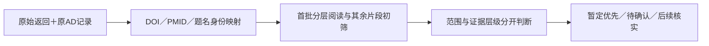

# 厌氧微生物氧暴露／氧冲击机制文献

本工作线为微曝气AD综述解释损伤、防御、代谢、互作、空间和恢复机制，允许非AD的纯培养、酶学及自然环境研究。它与原AD库关联，但不继承旧AD排除结论；没有要求omics。原分类和用户判断保留，新范围筛选是助手模型判断。

**先读：[详细方法（范围、逐阶段判断、四个真实案例、局限）](methods/METHODS.md)**。复现实际查询看[检索式附表](methods/QUERY_APPENDIX.md)；核数量关系看[逐ID集合表](methods/flow_membership_utf8.csv)。本次是方法整理，不新增检索或重筛；整合前报告在页底折叠。

## 实际过程

2012-01-01至2026-10-24，PubMed按对象、氧情境和机制分17组；Crossref做3组相关性文本补充，各取100；OpenAlex做3组题名/摘要查询并翻cursor。另从2020年Bacteroides原始研究的参考文献选4 PMID，并取32条前向引用。早期机制研究另标。MCP返回内部错误、CLI429没有算成功，实际结果来自官方API；WoS/Scopus未检索。

从AD扩展时优先具体功能与靶点，而非同门同科；急性冲击、持续微氧、反复暴露和去氧恢复分开。H2O2/ROS或化学调ORP不冒充直接O2干预；基因/组学不直接等于活性、互作或因果。

## 当前数量分别指什么

|对象|数量及含义|
|---|---|
|原始检索输入|1,147行，组间/来源可重复；Crossref尾部仍未补|
|返回身份与关联池|1,039返回身份；57关联原库、982新身份；旧554全部保留，池1,536|
|首20|10读相关全文段落、10仅摘要；范围17+离体酶学1+待确认2。后来推荐17不是同一“范围17”集合|
|新增1,516|题名/摘要关键句初筛：347候选、477待确认、336背景、356排除；不称完整摘要/全文审阅|
|累计优先/待确认|364暂定优先=新增347+原17推荐；479待确认=477+原2；另1条DAMO范围相关但精读暂缓不在这两队列|
|新35阅读队列|从347候选跨主题指定，后来读完完整缓存摘要；新增全文核实0。其余312候选继续核实，35不是终选上限|

引用统一OpenAlex快照、期刊指标沿用2024机构索引缓存；缺值留空，无“高被引/高JIF”统一阈值。原20有具体主张验证关联，但未确认同对象同条件严格独立复制；新35也不能称广泛验证。详见方法的五维评价和阅读深度表。

## 文件和下一步

- [同一累计Excel](oxygen_response_review_cumulative.xlsx) · [总表CSV](literature_master_utf8.csv) · [catalog JSON](catalog.json)
- [364暂定优先](all_pool/provisional_priorities_utf8.csv) · [479待确认](all_pool/pending_confirmation_queue_utf8.csv) · [原20五维评价](reading_priority/evaluations.json)
- [35篇逐篇来源/条件/阅读深度](reading_queue35/README.md) · [其余312续跑](reading_queue35/other_in_scope_continuation_queue.json) · [机制进度](all_pool/progress.json)
- [原始查询日志](search_log.json) · [返回到ID映射](dedup_input_mapping_utf8.csv) · [身份冲突](identity_conflicts.json)

机制工作线已因切换数据发现而暂存。后续先补待确认记录的完整摘要/必要全文，核35及其他候选的具体主张；不重跑主题检索，不重复查询原20指标。P001/P002未保存当时所示片段、Crossref截断、P012错位更正、版本冲突和访问失败均在详细方法中明示。这里没有用本次新阅读改写旧判断。

## 可见的阶段入口与原文记录

本工作线依次完成首轮发现与首20分层阅读、原20五维精读评价、其余全池关键句初筛、35篇完整缓存摘要及来源澄清；这些属于研究主体，不以最新阶段覆盖前面阶段。上文正常可见地说明阶段关系，详细查询、案例与局限均保留在[完整方法](methods/METHODS.md)。[全项目介绍](../README.md#stage-5)将本工作线接回最初AD检索、原件/JCR和组学过程。

|阶段|原有成果/方法入口|尚未完成的边界|
|---|---|---|
|首轮与B001|[首轮协议](PROTOCOL_zh.md)、[机制框架](MECHANISM_SYNTHESIS_zh.md)、[首20表](batch_B001_results_utf8.csv)|10相关全文段落、10摘要不是20篇全文通读；Crossref尾部未取|
|原20五维评价|[评价与具体主张](reading_priority/README.md)|17推荐有8篇仅摘要，严格同对象独立复制未确认|
|全池首遍|[全池过程](all_pool/README.md)、[逐项判断](all_pool/semantic_screening_records_utf8.csv)|关键句可截断，P001/P002显示片段未保存；不是完整摘要/全文|
|35来源/完整摘要|[逐篇来源与条件](reading_queue35/README.md)|仅完整缓存摘要，仍是优先阅读队列；其余候选继续核实|

逐轮过期“下一步/未筛”回执可由[历史附录](../HISTORY.md)及[9208原文快照](https://github.com/Colliam-Vermilion/FirstCodex/blob/9208deddd624e99b1314bac359c22349c8554c64/results/ad-oxygen-literature-20261006/oxygen_response_review/README.md)核对。本页不再用整体折叠隐藏研究介绍，既有筛选、评价和全文证据没有重写。
