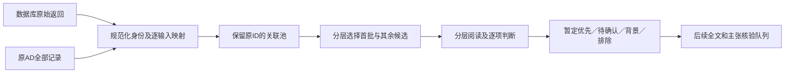

# 厌氧微生物氧响应机制检索：实际执行方法

本说明依据截至提交 `0f9eeec20bc23a421165c8cff352137ba68fac48` 的脚本、原始响应、逐条判断和Git历史重建。本次只做离线方法审计，没有新检索、重筛、补全文或更新指标。这里描述的是一次有明确截断和分层阅读深度的补充检索，不是事后补写的穷尽性系统综述方案。

[当前入口](../README.md) · [全部实际检索式/参数/原始返回](QUERY_APPENDIX.md) · [逐ID集合核对CSV](flow_membership_utf8.csv) · [集合审计JSON](set_flow_audit.json) · [提交阶段证据](../../method_audit/stage_history.json)

## 1. 为什么扩展原AD文献库

原库围绕微曝气厌氧消化（AD）的工艺与组学，容易把非AD纯培养、酶学或沉积物机制研究排除在外。本轮要解释氧进入原本厌氧环境后，损伤、清氧/抗氧化、电子流和碳代谢、互营、空间保护以及恢复为什么发生。因此将对象扩展到产甲烷/互营培养、严格厌氧菌、沉积物/湿地/淹水土壤、肠道和瘤胃等体系，而不要求文章出现omics或sequencing。

选择产甲烷古菌、互营脂肪酸氧化菌、产乙酸/发酵菌和相关硫循环微生物，是因为它们对应AD的具体功能；选择Bacteroides等非AD对象，是为了比较明确的氧敏靶点或防御系统，不是因为“同为厌氧菌”或同门同科就能外推。非AD研究必须保留底物、温度、盐度、宿主、扩散和还原性培养基的差异。

|边界|实际采用的口径|
|---|---|
|主题检索时间|PubMed P01–P17、Crossref C01–C03、OpenAlex O01–O03均发送2012-01-01至2026-10-24过滤；不是默认检索所有年代|
|早期研究|从实际引用链选定4个PMID核验，其中2001/2004/2008三篇早于2012；后续机制关联另有1993等早期支持。原554条导入时没有重新按2012裁切|
|核心范围候选|厌氧背景中有氧进入/微氧/暴露史及可解释的微生物响应，或对该问题有明确直接生化意义的原始证据|
|机制背景|综述、理论/模型、仅ROS或其他氧化还原处理可作背景，单列，不冒充直接O2暴露原始研究|
|排除/待确认|常规好氧或非微生物研究、仅缺氧无氧进入、没有可辨微生物机制的性能文章；摘要片段不够时保留待确认，而非靠未出现关键词断言没有证据|
|研究类型|纯培养、共培养、酶学、遗传干预、代谢物、同位素、微电极、组学均可；不以文献指标替代范围判断|

这是本轮判断框架。全池首遍并没有逐篇验证所有处理细节，不能把框架要求写成每篇都已满足。

## 2. 实际信息来源和工具分工

|来源/工具|实际完成|不能据此声称的工作|
|---|---|---|
|nature-academic-search|保存记录指向恢复版本b543e8b998eb2df1fd44641cc8b262c638c2b442；当时列出16个MCP工具|MCP结果虽isError=false但内含source request failed，CLI也有429；安装/可列工具不等于检索成功|
|PubMed官方ESearch/EFetch|17组主题查询、完整ID和EFetch；具体字段自动映射、排序、警告可查|不是WoS/Scopus覆盖，也不等于阅读全文|
|Crossref works API|3组query.bibliographic，每组100条|它是相关性文本检索，不是严格布尔式；没有补齐每组巨大报告尾部|
|OpenAlex works API|3组题名/摘要检索和一个种子前向引文；之后按DOI补引用/摘要|后来的指标补全不是再次发现检索|
|PMC/原库原件|8篇有body的JATS、2篇已有PDF用于B001相关段落，另10篇依据摘要|只有front的XML、reCAPTCHA网页、HTTP200错误页都不计全文|
|Europe PMC|旧摘要记预检500，但请求日志证明后来3篇正文HTTP200且有body；最终证据登记采用NCBI版本|不是另一个完成主题检索的来源；不重复计3篇正文，不能概括成正文都失败|
|WoS、Scopus|未具备可用授权/接口，未检索|不填造命中数或声称覆盖|

证据：[来源可用性](../source_availability.json)、[原请求日志](../request_log.jsonl)、[正文来源登记](../source_document_register.json)、[网页误返回验证](../reading_priority/html_access_validation.json)。nature-downloader/ScanSci在原项目的安装不能当作本轮机制数据库检索已使用；原件优先复用。实际调用由[search_round1.py](../scripts/search_round1.py)等Python脚本直连官方API完成。

## 3. 为什么拆成多组，实际搜了什么

检索并非要求一篇同时出现所有条件，而是将下列维度按具体问题组合，兼顾宽召回和特定机制：

|概念维度|实际词例|组合和目的|
|---|---|---|
|氧情境|oxygen exposure/shock/stress/tolerance、microoxic/microaerobic、reoxygenation、oxygen pulse、redox fluctuation|把首次冲击、长期低氧和恢复的研究带入候选池|
|厌氧对象/体系|methanogen*、syntroph*、Clostrid*、Desulfovibrio、Bacteroides、gut/rumen、sediment/peat/wetland、anaerobic digestion|既覆盖AD功能团，也寻找可迁移的生化原理|
|机制/方法|rubrerythrin、superoxide reductase、flavodiiron、iron-sulfur、enzyme inactivation、microelectrode、cross-feeding、recovery|将酶、细胞和群落层证据分别召回，不预设组学必需|

例如，机制P02将厌氧对象与三类防御蛋白和oxygen/oxidative相交，目的是找到防御系统原始证据；P05以颗粒/生物膜和微电极/扩散词寻找空间证据；P07关注湿地/泥炭中的反复红氧和再氧合。完整式均含实际发送的时间过滤，见[25行总表及逐组全文式](QUERY_APPENDIX.md)。P10较宽，包含superoxide与酶损伤，召回的间接ROS研究仍须后续分流，不能因为命中就认定直接氧暴露。

PubMed输入没有统一限定Title/Abstract，而由自动映射处理；实际translation保留在ESearch。ESearch `retmax=9999, sort=pub date`，各组未触及9999，EFetch每100个ID。Crossref发送 `rows=100`，不翻后页，未显式指定sort；仅解释为默认相关性文本结果。OpenAlex使用 `title_and_abstract.search`、`per-page=200`、cursor；主题脚本设1000条上限，但三组实际64/10/5均自然结束。不要把OpenAlex的已完成分页推广成Crossref也完整。

代表性实际输入（含原时间窗，以下是机制工作线的查询ID）：

P02：

```text
((anaerob* OR methanogen* OR Clostrid* OR Desulfovibrio) AND (rubrerythrin OR "superoxide reductase" OR flavodiiron) AND (oxygen OR oxidative)) AND ("2012/01/01"[Date - Publication] : "2026/10/24"[Date - Publication])
```

P05：

```text
((anaerobic OR methanogenic) AND (granul* OR biofilm OR aggregat*) AND ("oxygen gradient" OR microelectrode OR "oxygen penetration" OR "oxygen diffusion")) AND ("2012/01/01"[Date - Publication] : "2026/10/24"[Date - Publication])
```

P07：

```text
((peat OR wetland OR "flooded soil") AND ("redox fluctuation" OR "redox oscillation" OR reoxygenation OR "oxygen exposure") AND (microb* OR methanogen* OR metabol*)) AND ("2012/01/01"[Date - Publication] : "2026/10/24"[Date - Publication])
```

### 命中驱动的扩展和引用追溯

实际先有P01–P14、C01–C03和O01–O03；读取候选后，再加入P15–P17。请求时间在附表，可见扩展确实晚于首轮请求。

|依据|实际动作|未完成部分|
|---|---|---|
|B. thetaiotaomicron 2020，DOI 10.1111/mmi.14516，区分O2/ROS的PFOR研究|P15增加PFOR/PFL词；从其85条参考文献中取4 PMID做T01；OpenAlex按cites:W3016413973做F01，取回32条|85条仅4项被选定取元数据，余81没有完成该后向核验；没有第二个系统前/后向种子|
|R07202的bd/SOR基因模型，与Akkermansia生理/互补线索|P16增加cytochrome bd/bd-type|不是已证明AD群落bd通量或所有厌氧菌以氧获能|
|PMID38580315的蛋白组和间接氧侵入判断|P17增加selenoproteome/selenocysteine|没有因此补上直接DO操纵或硒途径因果证据|
|Clostridia综述及瘤胃线索|保存riboflavin、PerR、sigma B、oxygen uptake/rumen yeast等未来扩展词|这些新增建议没有执行额外查询，不能算已覆盖|

T01指定PMID为14749831、11260473、18161989、29559534，不是另一次全面历史检索。F01限定2012年至当日；32条为引用该种子的记录，不是32条支持性验证。原始参考文献、取回状态及前向参数见[citation_trace.json](../citation_trace.json)、[forward_trace_log.json](../forward_trace_log.json)、[term_expansions.json](../term_expansions.json)。精读评价时另按20篇的具体主张选择8篇原始研究作针对性核验，PMID固定列表在[fetch_priority_evidence.py](../scripts/fetch_priority_evidence.py)，并非再运行一个全面引用网络检索。它们仅作为具体主张的补证，不自动新增8篇范围筛选完成量，见[support_studies.json](../reading_priority/support_studies.json)。

## 4. 原始返回如何变成全池



|来源或阶段|实际记录量|统计单位|
|---|---:|---|
|PubMed主题17组|732|查询返回行，组间可重复|
|Crossref 3组|300|各组前100行，非穷尽|
|OpenAlex主题3组|79|查询返回行|
|T01指定PMID|4|元数据返回行|
|F01前向引用|32|引文记录|
|合计|1,147|不能直接叫纳入论文|

身份处理由[build_catalog.py](../scripts/build_catalog.py)执行：DOI去doi.org/doi:前缀、小写；PMID精确匹配；题名HTML还原、Unicode规范化、去非字母数字。题名相同但DOI冲突、年份差大于1年等不强并；多个身份匹配保留冲突。旧R编号优先保留，新身份取DOI/PMID/题名优先键的SHA256前12位生成OR-ID。它不是凭近似标题自动判断同一实验。

本次直接逐行读取[输入—ID映射](../dedup_input_mapping_utf8.csv)和catalog计算集合，**不是由几个总数相减猜测**：

|集合|实测大小|解释|
|---|---:|---|
|O：原CSV对应旧ID集合|554|全部保留，旧AD排除也进入新范围池|
|R：本轮返回被分配的ID集合|1,039|包含多来源合并后的身份，不保证已解决全部版本问题|
|O∩R|57|原库被本轮重新命中的身份|
|R\\O|982|原库外身份|
|O\\R|497|本轮未再命中但仍保留的原库身份|
|O∪R|1,536|实际catalog，等于554原ID加982新身份|

[逐ID集合成员表](flow_membership_utf8.csv)允许查到每条属于哪些集合、命中哪些查询及原始响应。14项身份冲突继续保留；[同题版本提示](../all_pool/possible_version_groups.json)另有11组，不静默合并，也不视为独立支持。原554条分类和用户人工判断只是保留字段，不能自动决定新范围结论。已有[原库保护验证](../validation.json)记录133列及用户判断未改；新的模型判断不是用户人工复核。用户原始判断可追至[原始分类文件](../../methods/manual_classification_20261007_original.csv)和[补充分类文件](../../methods/manual_classification_pending36_20261007_original.csv)。

历史首个发现提交374049c50还只有1,138返回；随后P15–P17新增9条输入，但它们都映射到已有身份，catalog仍为1,536。现在1,147是后续完整返回口径，旧快照不应当作另一个文献池。

## 5. 首批、全池初筛与35篇队列如何衔接

### 首批B001不是检索返回的前20篇

[prepare_sources.py](../scripts/prepare_sources.py)中固定20个PMID，按不同机制/体系及干预、生理证据线索选择；[选择表](../batch_B001_selection.json)保存顺序和理由，包含原AD排除的R11680重新判断。不是随机抽样、被引前20或可由一个预注册分数唯一推导的样本。模型实际读取来源后，将判断、剂量原单位、限制和短引写入[curate_B001.py](../scripts/curate_B001.py)、[screening.json](../screening.json)及[机制证据表](../mechanism_evidence.json)。脚本是保存已做判断的载体，不是自动语义判定器。

|B001口径|数量|区别|
|---|---:|---|
|范围判断|17符合核心范围、1离体酶学原始证据、2待确认|“核心范围”是范围标签，不是每条机制均已因果证实|
|实际阅读依据|10相关全文段落、10题名/摘要|全文来源为8 JATS+2 PDF；不等于全文通读全部附件|
|保存的阶段标签|9全文核实、9摘要初筛、2待确认|10篇读过全文段落中有1篇仍待确认，因此阶段数与阅读深度数不同|
|后来精读评价|17推荐、3暂缓；17中9全文依据、8摘要暂定|这是优先级，不替换范围判断|

尤其，**“范围符合17篇”与“精读推荐17篇”不是同一个集合**：交集16；DAMO记录OR-1925EF467A30范围相关但精读暂缓，离体酶学OR-5793389585C4进入精读推荐。精读层级6核心、4基础、7边界仍含暂定摘要推荐，不能全部称为已全文确认核心。

已读相关全文的10条具体支持与边界如下，均摘自保存的B001判断，**不是本次新增核验，也不是每篇全部主张已证实**：

|记录与来源|已存响应/主张|已存证据性质和限制|
|---|---|---|
|[OR-C8E113321FD5](../evidence_sources/OR-C8E113321FD5.json)；严格厌氧肠道菌纯培养：Bacteroides thetaiotaomicron|PFOR对O2直接失活，改变超氧/过氧化氢水平不改变其失活率；丙酮酸流受阻|遗传干预＋直接酶活；分离O2与ROS效应；菌株与酶特异；不能推广所有PFOR均同样敏感；未据此证明AD群落的净效应|
|[OR-7C60AA03CC08](../evidence_sources/OR-7C60AA03CC08.json)；产甲烷古菌纯培养：M. acetivorans C2A|适应株保持产甲烷与生长，首次暴露对照被抑制；ROS探针信号下降并伴多种防御与生物膜表型|重复暴露的生理/生化实测；防御机制多项关联；没有遗传遗传性/重测序证据，不能称进化适应；ROS探针并非特定ROS定量；还原剂影响实际暴露|
|[OR-30A5634DFFB8](../evidence_sources/OR-30A5634DFFB8.json)；污染沉积物来源的产甲烷苯降解富集群落（ORM2）|小暴露整体降解速率影响有限；较大冲击后Pseudomonas扩增、ORM2下降、产甲烷苯降解长期停滞后恢复|受控处理＋化学活性和绝对丰度时间序列；群落机制关联；较大空气量依顶空估计；瓶数/暴露历程有限，qPCR不等同活细胞；不能把恢复称遗传适应|
|[R07202](../evidence_sources/R07202.json)；Napier grass连续搅拌AD反应器；Proteiniphilum与产甲烷菌|重建cytochrome bd、SOR/rubrerythrin等基因潜力及互补代谢；不是本实验实测氧还原/ROS清除通量|功能潜力＋性能背景；机制主要为作者重建/推测；仅2个重复有合格宏基因组；ORP不可唯一换算O2；基因编码不等同活性；没有因果互作或DIET证明|
|[R13862](../evidence_sources/R13862.json)；S. zehnderi＋M. formicicum＋两株Pseudomonas合成共培养|四菌体系微氧下油酸转化加速；Pseudomonas可消耗中间产物，作者提出耗氧保护和替代H2/甲酸清除|组合培养＋实测产物/底物；具体保护路径含推断；连续阶段同时改变底物/运行方式/供氧，存在混杂；部分还原剂缓冲；非DIET证明；各O2组不能合并|
|[OR-06716459121E](../evidence_sources/OR-06716459121E.json)；M. barkeri与Methylocystaceae好氧甲烷氧化菌的限氧MBR共培养|稳定共存且FISH紧密聚集；作者认为甲烷氧化菌耗氧使产甲烷菌受保护|共培养与化学活性/空间成像直接观察；保护因果仍为解释；缺少足够去除伴生菌/空间氧微剖面对照以单独证明保护；好氧菌同时耗用甲烷|
|[OR-6A3D9B1E5D73](../evidence_sources/OR-6A3D9B1E5D73.json)；缺氧Baltic沿岸沉积物完整柱芯|再氧合后Arcobacter扩增，硫/硫化物氧化与固氮转录持续，表面白膜与硫循环变化|直接O2处理/氧剖面及化学＋转录；固氮功能通量未直接证明；完整柱芯存在扩散/硫铁/氮反应混杂；白膜硫归属为作者解释；RNA不等于实测固氮通量|
|[OR-3035DF955A54](../evidence_sources/OR-3035DF955A54.json)；Sphagnum泥炭浆液/天然微生物群落|先氧化后厌氧的泥炭甲烷产量显著提高；好氧芳香碳处理与后续氢营养产甲烷相联系|处理对照＋产物/地球化学实测；类群代谢分工/类Fenton贡献仍含推测；最高2000倍为特定对照/土层，不能泛化；未直接测定全部跨营养通量；pH3.7–4.2与铁化学混杂|
|[OR-6FAF906F2BA4](../evidence_sources/OR-6FAF906F2BA4.json)；H2/CO2氢营养产甲烷群落；AQDS氧化还原缓冲|高ORP组ROS缓解及硒相关蛋白变化；作者提出动态硒蛋白组帮助氧化应激适应|蛋白组/甲烷测量；氧侵入为间接推断，因果归因待确认；DO未测；AQDS可改变电子流和化学环境，并非只改变O2；硒替换因果保护未干预|
|[OR-5DA7260E019E](../evidence_sources/OR-5DA7260E019E.json)；天然缺氧海岸沉积物单细胞群落：Chloroflexota等|O2条件下呼吸相关信号与转录方向可分离，不能由RNA降低就判功能停滞；laminarin影响单细胞活性|单细胞活性代理＋组学/化学；非直接每细胞硫酸盐通量全量测定；RSG是电子传递代理，硫酸盐还原速率依作者估算；宏转录仅加laminarin两样有足够RNA；O2单位表述有歧义|

### 原20之外的1,516条如何处理

先用[pool_metadata.py](../scripts/pool_metadata.py)复用已有书目信息、摘要和原20指标，再进行31次批量DOI元数据查询；不是新一轮主题检索。随后[pool_screen.py](../scripts/pool_screen.py)按氧情境、对象、机制词生成**仅供分流**的路由分数/主题，跨主题交替排队，包模式还有clear/molecular/compact等调整。

模型逐项看到题名和由脚本选出的摘要关键句后，写入独立[decisions目录](../all_pool/decisions/)；只有这些判断计首遍完成量。摘要包挑最多2个相关句，再截至约140/150/350字符（按模式），并非完整摘要。系统/微生物名、AD潜在关联和证据类型的一些字段还来自词规则，必须视为提示，而非已核实设计或物种对应。原20不重做。全池230条仍缺可用摘要，按题名分流；已有1306条摘要也不等于1306条都被完整阅读。

P003以后保存了当时包中显示的关键句；P001/P002没有保存当时显示片段，其字段中的摘要前450字符仅作定位，不能追认为逐字已读内容。模型版本、采样参数、逐步推理和独立第二审阅者没有保存，不能声称可精确重放模型思考或已做双人盲法筛选。判断本身、输入包和纠错可审计。

|全池对象/队列|数量|来源和重叠|
|---|---:|---|
|新增初筛判断|1,516|347范围/机制潜力候选+477待确认+336背景+356排除|
|暂定优先|364|新增347与原精读推荐17并集，二者不重叠|
|累计待确认|479|新增477与原20中2条并集；不是479篇已读全文后均无法判断|
|新35篇重点阅读|35|模型从新增347中按具体靶点/干预线索、跨主题覆盖指定，固定列表在pool_finalize.py的FOCUS|
|其余新增范围候选|312|新增347去掉35，仍继续核实，不是排除|
|重点展示集|52|原17推荐+新35，不是新增52篇完成精读|

35全部保留初筛“核心候选”标签，但规范含义是**待核的范围/机制潜力候选**；不是终选数量上限、指标前35或四项条件都达标。后来[reading_queue35](../reading_queue35/source_conditions_audit.json)逐篇读了完整缓存摘要、收窄理由，新增全文和独立验证均为0。30条有PubMed来源、6条OpenAlex、6条关联原库，这些来源重叠，不能相加。

当前四个大集合364优先、479待确认、336背景、356排除之外，另有**1条DAMO范围相关但精读暂缓记录**OR-1925EF467A30，所以不能把四个队列当全部记录的完整互斥划分。详见[集合核对](set_flow_audit.json)。

## 6. 情境、证据和指标是怎样评价的

B001记录实际处理，区分急性空气冲击、持续微氧、反复暴露、去氧恢复；全池的相关标签多来自文本线索，尚待核实际剂量/时序，不据标题把这些情境合并。单独H2O2、超氧、NO、药物/金属ROS和化学调ORP不自动等于分子氧输入。ORP也不唯一换算DO。

遗传缺失/恢复、直接酶学、共培养干预、代谢物/同位素和微剖面可提高具体主张的直接性；同一文章仍可能有推测。16S≠功能，基因≠活性，转录≠通量，共现≠互作，导电材料≠DIET，表型恢复≠遗传适应。原20五维评价分别记AD对应A1–A3、直接性D1–D4、具体主张验证关系，再附引用/JIF；不把它们加成能补偿范围缺陷的总分。

|维度|已做的事|尚不能声称|
|---|---|---|
|独立支持|原20有26行具体主张关联，核8篇原始支持元数据/摘要，另读2020 C. difficile相关全文；区分共享作者/团队和跨类群支持|没有确认同对象、同关键条件的严格独立复制；引用多、综述复述多不是独立验证。新增35均未核实严格复制|
|引用|统一OpenAlex，2026-10-24快照；全池1459有值、77缺；原20复用不重查|不设高被引阈值；不剔除自引/批评性引用，不是学科/同年百分位|
|年均引用|原20按数据库publication_date计算；全池排序另设最小1年，缺日用年份1月1日并标记|两个阶段公式不完全一样，不能事后写成同一种校正；新文指标仍不稳定|
|JIF/JCR|统一2024指标年/2025发布版，复用机构JCR栏目索引快照；原20有11条、原17推荐有8条；全池543个期刊/ISSN缓存键，412条有值|不是本轮Clarivate账户导出；缺值留空，不用CAS/SJR或期刊印象补齐|
|35篇四项条件|34有引用、9有JIF，1篇预印本不适用JIF；逐篇说明AD依据与限制|高被引/高JIF阈值未定义，0篇能确认四项全满足不等于35篇都不相关|

科学层内辅助排序实际先固定原17/新35优先，再看潜在AD关联、干预线索，之后用年均引用/JIF、ID打破顺序；35本身由模型指定，不是此排序算法选前35。规则和个别人工式列表均在[pool_finalize.py](../scripts/pool_finalize.py)。这里代码中的“人工/语义”指助手模型判断，不是用户或第二位研究者复核。机制线未完成所有补充附件阅读；正文表格/图注进入JATS定位，不等于所有独立SI文件已通读。[评价口径](../reading_priority/evaluation_policy.json)和[主张关联表](../reading_priority/mechanism_validation_links.json)保留分层证据。

## 7. 四个实际案例

### 直接分子氧机制：OR-C8E113321FD5

题名为 *Do reactive oxygen species or does oxygen itself confer obligate anaerobiosis? The case of Bacteroides thetaiotaomicron.*，DOI **10.1111/mmi.14516**。先由P10检出，扩展P15再次命中；来源是[原P10返回](../raw/pubmed/P10_fetch_00000.xml)，不是靠被引数选入。模型读取[官方JATS](../raw/pmc_fulltext/F32301184_jats.xml)的相关方法/结果，记录改变超氧/过氧化氢清除水平与PFOR失活的比较，支持特定条件下分子O2直接损伤，不能泛化所有PFOR不可修复。

B001范围符合，原20评价列**基础理论**，因为肠道菌与AD对象不同、但低电位代谢靶点可比。短引“molecular oxygen, rather than either partially reduced species”及段落路径在[该记录证据](../evidence_sources/OR-C8E113321FD5.json)和[机制表](../mechanism_evidence.json)。它又成为唯一系统前/后向种子；与2001同团队和2008不同对象研究的关系仍有适用条件，未确认AD原位独立复制。

### 读过相关全文仍待确认：OR-6FAF906F2BA4

DOI **10.1021/acs.est.3c07725**，由P01/P13检出，P17硒蛋白扩展再命中。读到[官方JATS](../raw/pmc_fulltext/F38580315_jats.xml)明确说氧侵入没有直接用DO测量，而由ORP升至50mV以上推断；AQDS处理同时改变电子流。相关段落定位保存在[证据文件](../evidence_sources/OR-6FAF906F2BA4.json)。

体系与AD/氢营养产甲烷相关、蛋白组也有响应，但尚不能区分O2效应、ORP与AQDS效应，也无硒途径因果干预。因此B001仍待确认，精读暂缓；不是因为没读全文，也不因JIF较高升级。下一步缺直接氧处理/对照和硒路径干预，不是再增加引用数。

### 非AD但有参考价值：OR-3035DF955A54

*The role of oxygen in stimulating methane production in wetlands*，DOI **10.1111/gcb.15831**，由P07检出。模型读[官方全文](../raw/pmc_fulltext/F34409684_jats.xml)§2.2/2.6等相关段落：泥炭0/5/10% v/v O2、98日氧化后134日厌氧，比较甲烷与碳化学。保存在[该记录证据](../evidence_sources/OR-3035DF955A54.json)，与后续PRJNA551662数据工作线相连。

范围纳入、精读列边界：可用于解释氧先改变底物、后改变产甲烷的时序，但不是“持续微氧直接促进甲烷”；低pH泥炭、层位、Fe和长时处理不能套到AD。具体跨营养/Fenton中介仍主要推测；JIF缺失没有阻止推荐。

### AD高度相关但机制多属潜力：R07202

DOI **10.1016/j.watres.2020.116721**，原库R-ID保留；P02/P11/P13/P16再次命中，见catalog provenance。读取[已保存PDF](../../original_files/R07202/fulltext/fulltext__published__7663ffc3d7b30f70.pdf)及[页码证据](../evidence_sources/R07202.json)，识别ORP控制、Proteiniphilum的bd与产甲烷菌SOR/rbr等宏基因组模型。

B001范围符合，精读却列“重要补充与边界”：基因编码/丰度没有证明酶活、耗氧或因果互作，ORP不能唯一换算作者所称picomolar O2。这不是因文献价值低，而是对主张强度的限制；也解释了为何高引用和Water Research指标不能让它变成已因果确认核心。数据审计后来发现项目内额外厌氧WGS，但时间/布局不匹配问题仍未解决。

## 8. 已知缺口、更正及如何复现

|问题|实际影响/处理状态|
|---|---|
|Crossref各取100|C01/C02/C03报告总量1,162,769/358,038/816,537，尾部未补；报告量不是相关研究量。仅完整保存已取回300，不具穷尽性|
|P001/P002片段未保存|保留可核原摘要及最终判断，但无法逐字重建当时模型看到的片段|
|P012漏项导致判断错位|保存的更正记录说明漏掉第16项后发生错位；4fa82ceca补漏并重新对应50个ID，最终判断包与decisions校验一致；不改成“从未发生错误”|
|同题/DOI冲突、版本|14项身份冲突和11组同题版本仍待核；没有以版本数当独立研究数|
|Europe PMC摘要与日志不一致|[旧摘要差异审计](source_summary_discrepancy.json)记录后续3篇成功正文；最初500仅有摘要说明，未保存对应完整失败请求详情。B001统一取NCBI版本，不能说Europe PMC全文从未成功，也不能把两个版本算两篇|
|正文可用性误判风险|NCBI front-only XML与HTTP200挑战页未计全文；Wiley403等失败保留，不升级摘要记录|
|空间/遗传/瘤胃覆盖|直接氧微剖面、同对象空间保护因果、真正遗传适应、瘤胃直接O2干预仍有缺口；主题命中数不能证明证据充足|
|后续状态|全池首遍结束、35完整摘要结束；机制工作线已暂存。待确认/背景/其余312候选未完成核实|

更正证据：[corrections.json](../all_pool/corrections.json)、[4fa82ceca提交](https://github.com/Colliam-Vermilion/FirstCodex/commit/4fa82ceca)。阶段依次为发现374049c50、B001 f9fdd267a、五维评价fd1601371、全池22374f2e4、35来源澄清d8e4ee595；[提交快照](../../method_audit/stage_history.json)保留当时数量，不能用旧“1516未筛”覆盖现状。

复现主要查询：用附表原输入、参数、时间窗及分页重放官方端点，数据库更新后数量可能变化；Crossref若另取尾部，应记作新检索。本轮不重放。复核身份和队列可从输入映射、集合成员表、已保存判断包/decisions及上述脚本离线计算；判断需要科研阅读，不能靠重跑关键词路由替代。离线重建本方法附表运行 `python results/ad-oxygen-literature-20261006/method_audit/rebuild_appendices.py`；不会联网，不会改变任何筛选或累计Excel。不要为了方法复核运行旧检索/curate/render脚本，它们会写入结果。
