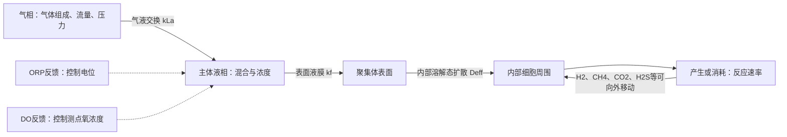

# 空间结构—气体传质的阅读导图

这是帮助比较研究尺度的示意，不是某个反应器已经测得的统一结构。[回科学首页](../README.md) · [专题累计Excel](../results/ad-oxygen-literature-20261006/oxygen_response_review/spatial_gas_transfer/spatial_gas_transfer_cumulative.xlsx) · [专题文献—命题表](spatial_gas_proposition_links_utf8.csv)

**接续状态：**233条本地候选均有初筛（5相关全文／旧证据、220整个缓存字段、2片段、6仅题名）；原始字段不一定等于正式完整摘要。专题关联由49增至68条，原49条关联保留。**在线补检尚未完成，12组查询未执行**；[运行策略与单次复测](../results/ad-oxygen-literature-20261006/oxygen_response_review/spatial_gas_transfer/raw/preflight/20261030_retest/README.md)显示四域名未在生效表，CONNECT拒绝发生在代理层。

## 先辨传质经过哪里，再看谁在那里

气液交换是跨界面进入/离开液相；外液膜是主体到聚集体表面的一段阻力；内部扩散描述溶解态分子在聚集体中的移动。细胞反应一面消耗、一面产生物质，决定了浓度梯度。图中没有假定气泡必须穿过污泥，也没有认为所有流动都能由一个Deff描述。

|先读的问题|首选材料及当前证据|不能跨越的解释|
|---|---|---|
|分层和产氢／产甲烷发生在哪里？|Satoh等2007；FISH＋H2/CH4/pH/ORP微剖面，**本轮仅缓存摘要**，[证据](../results/ad-oxygen-literature-20261006/oxygen_response_review/spatial_gas_transfer/evidence/ODS-PMID17905889.md)|特定颗粒有内层产乙酸古菌，不代表古菌总在中心；局部浓度剖面不是三维细胞坐标。|
|三维成像究竟重建了什么？|Gambelli等2018摘要明确电子断层；Wrede等2008为同切片光/电镜和EPS标记；[结构表](../results/ad-oxygen-literature-20261006/oxygen_response_review/spatial_gas_transfer/structure_localization_evidence_utf8.csv)|细胞电子断层、切片、共聚焦堆栈和整颗粒CT不能互称。CT种子尚未独立核实，不照抄题名结论。|
|表面积变化是否支持气液/润湿界面限制？|R03161改变桶放置/润湿面积并测H2S氧化；已读相关原文，p3–4/7–8|生物膜量、活性与面积共变；反应去除率不是纯物理kLa或扩散系数。|
|ORP、DO、固定输入分别控制什么？|R01414为ORP开关；R07202为相对基线ORP；R06080为非产甲烷颗粒DO反馈；[控制表](../results/ad-oxygen-literature-20261006/oxygen_response_review/spatial_gas_transfer/oxygen_control_evidence_utf8.csv)|测了DO不等于DO反馈；气相O2不等于液相DO；ORP电极基准不清时不能比较绝对值。|
|H2和甲酸是否一样？|Day等2022的代谢突变株竞争与搅拌；Hamilton等2015为模型；[交换表](../results/ad-oxygen-literature-20261006/oxygen_response_review/spatial_gas_transfer/cell_interfloc_exchange_utf8.csv)|遗传证据可区分载体，模型可提出条件；二者都不自动给出距离—通量测量。|
|混合／气泡供给与内部扩散是否同一件事？|Luo等2013粪便／乳清AD比较H₂扩散器及搅拌；[缓存证据](../results/ad-oxygen-literature-20261006/oxygen_response_review/spatial_gas_transfer/evidence/ODS-PMID23143533.md)|气液交换与pH／CO₂限制不同；没有从摘要取得kLa。|
|天然甲烷群落是否一定紧密球状？|Gründger等2019冷泉ANME-1丝束／斑块与SRB松散相伴；[缓存证据](../results/ad-oxygen-literature-20261006/oxygen_response_review/spatial_gas_transfer/evidence/ODS-PMID31278352.md)|CLSM尚未核堆栈／体重建；松散关联不是絮体间交换通量。|
|絮凝提高酸转化是否就是距离效应？|Pinela等2024高氨富集中的铁氧化物／非导电沸石与石墨烯比较；[缓存证据](../results/ad-oxygen-literature-20261006/oxygen_response_review/spatial_gas_transfer/evidence/ODS-PMID39110235.md)|絮凝、附着、磷沉淀和功能共变；需距离干预／载体通量，不能只归DIET。|

## 距离至少有三个尺度

1. **两个细胞之间：**短程H2／甲酸交换、产生者与消费者的反应耦合。要有实际距离或干预才能讨论最优距离。
2. **同一絮体内部：**内部扩散、空间分布和反应共同决定交换；不是对流均一的两细胞系统。
3. **不同絮体之间：**还要经过两侧表面、主体液相和混合流场。本轮已读材料没有直接核实跨絮体距离或气体通量测量，相关种子仍待全文。

H2是溶解态小分子；甲酸主要是液相物种，不应笼统画成气泡。CO2/H2S存在酸碱物种分布，温度、盐度、pH和压力也影响边界条件。

## 参数表应怎样读

|量|物理含义与常见单位|本轮可写到什么程度|
|---|---|---|
|D / Deff|分子／有效扩散系数，m²/s|Satoh摘要H2 Deff=2.66×10^-5 cm²/s；PVA-E人工膜O2 D=0.42×10^-4 cm²/s；Anammox凝胶De约颗粒3倍但探针溶质未核。这是三类材料／参数，不能混并；温度、测量／拟合和失活与否待全文。|
|kL / kf|界面或液膜传质系数，m/s|已读材料未取得可独立核实的直接测定数值，不拿模型假定或反应率补空。|
|kLa|体积传质系数，s^-1等|不是气流量，也不是DO。当前没有已全文核实可直接汇总的kLa测量值。|
|J|单位面积物质通量，mol/(m²·s)等|要注明物种、界面面积和梯度。脱硫g S/(m²·d)是反应器面积归一去除率，不能不加限定当无反应物理传质通量。|
|反应速率|产生/消耗物质的速率，基于体积、质量或生物量|受菌量、活性、底物和传质共同影响；不能由甲烷增加唯一反推Deff增大。|

Fick定律把浓度梯度与扩散通量联系起来：一维、连续介质近似下，$J=-D_{eff}dC/dx$。有反应时必须再给反应项和边界条件；不能把失活颗粒的扩散测量直接写成活性颗粒的净通量，也不能不说明条件就推广一个氧穿透深度。

## 本轮仍需哪些证据

网络恢复后优先独立核对五篇种子；S02已有旧官方元数据和42条完整参考文献，其他4篇仍未独立取回。重点补三维CT原图/分割方法、经典H2距离研究、絮体动态模型，以及扩散参数的活性/失活材料和温度。现在[本地未开始队列](../results/ad-oxygen-literature-20261006/oxygen_response_review/spatial_gas_transfer/remaining_queue.json)为空；后续应从[摘要源缺口](../results/ad-oxygen-literature-20261006/oxygen_response_review/spatial_gas_transfer/abstract_pending_queue.json)、[全文／疑点](../results/ad-oxygen-literature-20261006/oxygen_response_review/spatial_gas_transfer/fulltext_pending.json)及[12组在线查询](../results/ad-oxygen-literature-20261006/oxygen_response_review/spatial_gas_transfer/online_query_queue.json)继续。不能把初筛结束写成全文或在线补检完成，也不把外部0新增视为检索无结果。
